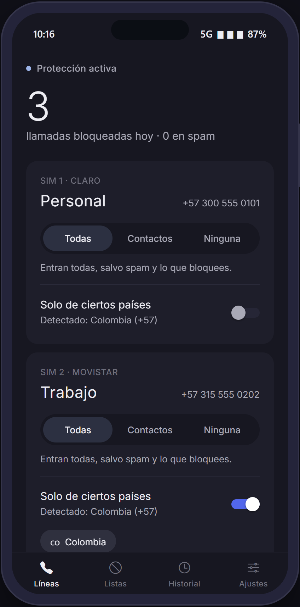
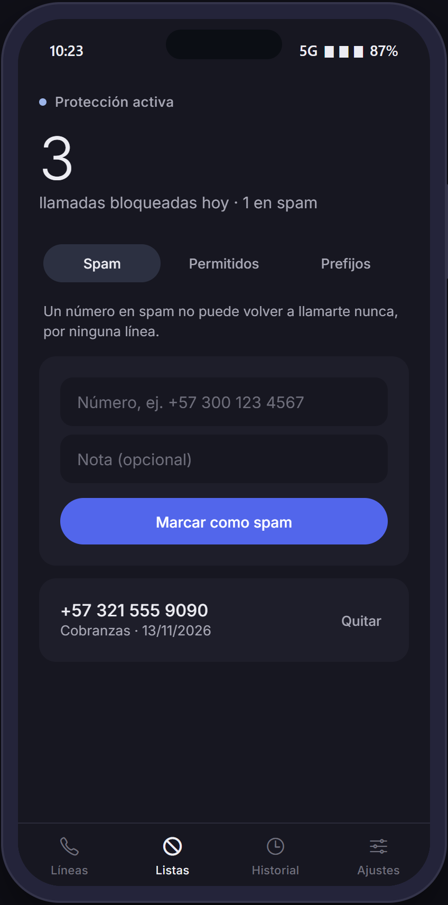
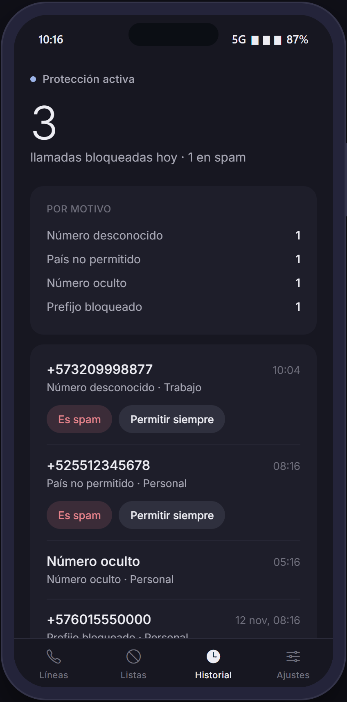
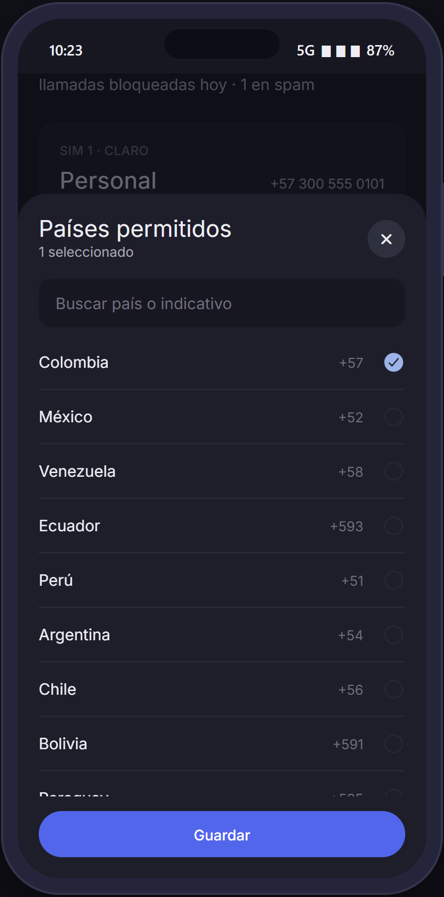
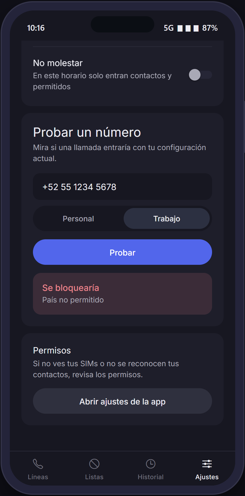

# Filtro de llamadas

App Android para decidir qué llamadas entran a tu celular. Funciona **por SIM**, **por país** y con una **lista de spam**
de la que no se sale. Todo se guarda en el teléfono, sin cuentas, servidores ni internet.

<p align="center">
  
  
  
</p>

## Descargar

**[Descargar APK](https://github.com/kevvj/filtro-llamadas/releases/latest/download/filtro-llamadas.apk)** (Android 10 o superior)

1. Abre el enlace desde el celular y descarga la APK.
2. Si Android lo pide, permite instalar apps de esta fuente.
3. Abre la app, acepta los permisos (teléfono, contactos y notificaciones) y toca **Activar filtro**.
   Android te pedirá elegirla como *app de filtro de llamadas*: sin ese paso no puede bloquear nada.

### Actualizaciones automáticas
Solo hay que instalarla una vez. Al abrirla, la app revisa si hay una versión nueva en los
[Releases de este repo](https://github.com/kevvj/filtro-llamadas/releases/latest), la descarga, la instala y se
vuelve a abrir sola. La configuración, el spam y el historial se conservan.

- La primera vez Android pide permitir que la app instale actualizaciones, y confirmar esa primera actualización.
  Desde Android 12, las siguientes son automáticas.
- Si Android no deja reabrirla sola, aparece una notificación *Filtro de llamadas actualizado*: un toque y abre.
- La versión instalada se ve al final de **Ajustes**.

## Qué hace

### Reglas por línea
Si tienes dos SIMs, cada una tiene su propia regla:

| Opción | Qué entra |
|---|---|
| **Todas** | Todas las llamadas, salvo spam y lo que bloquees aparte. |
| **Contactos** | Solo tus contactos y los números permitidos. Los desconocidos no entran. |
| **Ninguna** | Nada por esa línea, salvo los números permitidos. |

Ejemplo: la SIM personal recibe todo y la del trabajo solo contactos; o una línea solo para datos que no recibe llamadas.

### Solo llamadas de ciertos países
La app detecta tu país por el número de tu SIM (+57, +52...) o, si no lo tiene, por el país de la SIM o de la red.
Al activar la opción, por defecto solo entran llamadas de ese país. Puedes agregar otros o cambiarlo por completo
desde un buscador de países. Se configura por línea.

<p align="center">
  
  
</p>

### Spam
Un número marcado como spam **no vuelve a entrar nunca**, por ninguna línea, aunque esté en tus contactos.
Se puede marcar a mano o con un toque desde el historial. Quitarlo pide confirmación.

### Además
- **Permitidos**: números que siempre entran, aunque la línea filtre desconocidos o países.
- **Prefijos bloqueados**: todos los números que empiecen igual (por ejemplo `+57601` o `900`).
- **Números ocultos**: bloquea las llamadas privadas o sin número.
- **No molestar**: en un horario (por ejemplo 22:00 a 07:00) solo entran contactos y permitidos.
- **Historial**: cada llamada bloqueada con su motivo, la línea y la hora, y un resumen por motivo.
- **Probar un número**: dice si una llamada entraría o no, y por qué, sin esperar a que llamen.
- **Interruptor general** para apagar el filtro sin perder la configuración.

### Orden en que se decide

```
filtro apagado → entra
número oculto  → se bloquea si está activado "Bloquear números ocultos"
spam           → se bloquea siempre
permitidos     → entra siempre
línea "Ninguna"→ se bloquea
prefijo        → se bloquea
país           → se bloquea si no está en la lista de esa línea
contactos      → si la línea es "Contactos" o es horario de No molestar, solo entran contactos
```

Las llamadas bloqueadas se rechazan sin sonar y quedan en el registro de llamadas del teléfono.

## Privacidad
- No hay servidor: la configuración y el historial viven solo en el teléfono.
- La app no envía datos a ningún lado: no tiene cuentas, analíticas ni conexión a servidores.
- Los contactos solo se consultan en el momento de una llamada para saber si el número es conocido.

## Cómo funciona por dentro

```
React Native (src/)  ──  guarda la config en JSON  ──►  SharedPreferences
                                                          ▲
Android ── llamada entrante ──► FilterScreeningService ───┘ lee reglas, decide, rechaza y anota
```

- **Interfaz**: React Native con Expo (SDK 58) y TypeScript. Pestañas: Líneas, Listas, Historial y Ajustes.
- **Filtro real**: módulo nativo local en Kotlin (`modules/call-filter`), basado en el
  [`CallScreeningService`](https://developer.android.com/reference/android/telecom/CallScreeningService) de Android.
  La SIM de cada llamada se identifica con su `PhoneAccountHandle`.
- **Diseño**: basado en el DESIGN.md de Mercury (modo noche) de
  [awesome-design-md](https://github.com/VoltAgent/awesome-design-md). Copia en `diseno/mercury-DESIGN.md`.

```
src/
  App.tsx              estado, permisos y pestañas
  config.ts            tipos, valores por defecto, guardar y cargar
  countries.ts         países e indicativos
  screens/             Lines, Lists, History, Settings, CountryPicker
  ui.tsx, theme.ts     componentes y colores
modules/apk-updater/                     descarga e instala versiones nuevas y reabre la app
modules/call-filter/
  android/.../FilterEngine.kt            reglas y decisión
  android/.../FilterScreeningService.kt  servicio que filtra las llamadas
  android/.../CallFilterModule.kt        funciones para JavaScript
  demo.ts                                imitación del módulo para la vista previa web
```

## Desarrollo

Requisitos: Node 22+, JDK 17 y Android SDK.

```bash
npm install
git config core.hooksPath .githooks   # una vez: revisa todo antes de cada push
npm run check                         # lint + tipos + pruebas
npx expo start --web                  # vista previa en el navegador
```

La vista previa web se ve dentro de un marco de celular en `http://localhost:8081/telefono.html`. Usa 2 SIMs de
ejemplo y la misma lógica de filtrado escrita en JavaScript (`modules/call-filter/demo.ts`); si cambias
`FilterEngine.kt`, cambia también ese archivo.

Para compilar la APK:

```bash
npx expo prebuild -p android          # genera la carpeta android/
cd android && ./gradlew assembleRelease
# APK en android/app/build/outputs/apk/release/app-release.apk
```

> En Windows la compilación nativa falla si la ruta del proyecto es larga (límite de 260 caracteres).
> Usa una ruta corta (por ejemplo `C:\fl`) o deja que GitHub Actions compile.

## Control de calidad

Nada llega a la APK sin pasar estas revisiones (`.github/workflows/ci.yml`), en cada push y pull request:

| Revisión | Qué frena |
|---|---|
| **ESLint** (`npm run lint`) | Errores de código, malas prácticas de React, `eval` o código armado desde texto, `console.log` olvidados. Cero advertencias permitidas. |
| **TypeScript** (`npm run typecheck`) | Tipos que no cuadran, propiedades inexistentes, imports rotos. |
| **Pruebas** (`npm test`) | Cambios que rompan el filtro: spam, países, reglas por SIM, permitidos, prefijos, ocultos y No molestar (`tests/engine.test.ts`). |
| **gitleaks** | Contraseñas, tokens o llaves subidas por error, en todo el historial. |
| **npm audit** | Dependencias con vulnerabilidades graves conocidas. |
| **Dependency review** | En pull requests, dependencias nuevas con fallos graves. |
| **npm ci** | Un `package-lock.json` que no coincida con `package.json`. |

### Publicar cambios
Hay dos caminos, y el CI elige solo:

| Cambio | Cómo llega al celular |
|---|---|
| **Solo JS** (pantallas, textos, botones, lógica en `src/`) | Push normal. El CI publica una actualización OTA en GitHub Pages y la app la baja al abrirse (`expo-updates`). Sin APK. |
| **Nativo** (dependencias, `app.json`, `app.config.js`, `modules/*/android`) | Hay que subir la versión: el CI compila APK nueva. Si cambias algo nativo sin subirla, el CI falla y lo avisa. |

Las OTA solo llegan a las APK de la misma versión (`runtimeVersion` = versión).

```bash
npm run nueva-version              # 1.1.0 → 1.1.1 (o: minor, major, 1.4.0)
git commit -am "Versión 1.1.1" && git push
```

Si todo pasa y esa versión no tiene release, el workflow compila la APK y la publica con `version.json` (lo que lee
el actualizador) en el release `vX.Y.Z`, y borra los anteriores: siempre queda solo el último. El `versionCode` sale de la
versión (1.2.3 → 10203). Además, el hook `.githooks/pre-push` corre
`npm run check` en tu PC y cancela el push si algo falla.

Para probar el bloqueo en un emulador: `adb emu gsm call +573001234567`.

## Limitaciones
- Solo Android 10 o superior (el rol de filtro de llamadas no existe antes). No hay versión de iOS.
- La APK está firmada con una llave de pruebas: sirve para instalarla, no para publicarla en Google Play.
- Si otra app ya es el filtro de llamadas del teléfono, hay que elegir una de las dos.
